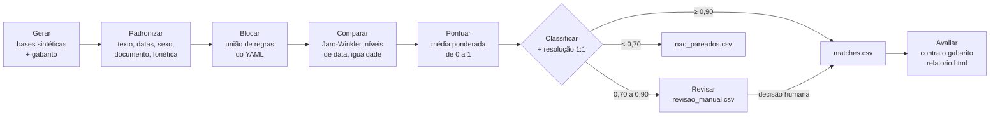

# record-linkage-kit

[Português](README.md) | **English**

[](https://github.com/agdala/record-linkage-kit/actions/workflows/ci.yml)
[](https://agdala.github.io/record-linkage-kit/)

Deduplication and linkage of person registries (record linkage) in Python, with human review, pseudonymization and evaluation against a ground truth.

**Evaluation report (GitHub Pages):** <https://agdala.github.io/record-linkage-kit/>

An operational registry of **5,000 records** is linked to a government list of **3,000
records**, full of realistic errors, with data governance and the principles of the LGPD (Brazil's
General Data Protection Law) as a good-practice reference. The result is measured against a ground truth.

> [!IMPORTANT]
> **All data is 100% synthetic**, generated with Faker and a fixed seed. No name, document or date
> belongs to a real person, and no secret is versioned. The numbers in this README are the ones
> obtained with `make run` and are in [`reports/metricas.json`](reports/metricas.json); CI checks
> that they are reproduced on every push.

---

## 1. Problem

Humanitarian organizations and public agencies register the same people in different systems.
Linking these databases is necessary to avoid duplicated assistance, to find people who have not
yet accessed a right and to unify each person's history. But there is no reliable common identifier:

- the document is missing in a large share of the records (40% in the synthetic government list);
- names appear without accents, without "de", "da" and "dos", with surnames in a different order,
  abbreviated or with typos;
- dates arrive with day and month swapped, recorded as 01/01 when only the year is known, or missing;
- the person moves to another municipality (for example, through interiorização (Brazil's
  voluntary internal relocation programme));
- there are twins, siblings and namesakes who look like the same person.

The project shows the full process, end to end, with a simple, hand-written implementation (no
Splink, dedupe or recordlinkage), and measures it against a known ground truth.

## 2. Flow



_Diagram labels are kept in Portuguese, as in the code: generate synthetic bases and ground truth →
standardize → block → compare → score → classify with 1:1 resolution → automatic matches, manual
review or non-matches → evaluate against the ground truth._

The same flow runs on base A against itself for **deduplication** (`reports/duplicatas_a.csv`).
In parallel, the **pseudonymized mode** (`rlk pseudo`) links using only hashes, with no names in
clear text (section 6).

## 3. How to run

### 3.1 On Windows, with Visual Studio Code

1. Install **Python 3.10 or later** (Microsoft Store, "Python 3.12") and the **Python** extension
   in VS Code (`Ctrl+Shift+X`, search for "Python").
2. Clone the repository: `Ctrl+Shift+P`, type **Git: Clone** and paste
   `https://github.com/agdala/record-linkage-kit`.
3. Open the terminal (**Terminal > New Terminal**) and run, one command at a time:

```bash
python -m venv .venv
```

```bash
.venv\Scripts\Activate.ps1
```

```bash
pip install -e ".[dev]"
```

```bash
rlk generate
```

```bash
rlk link --config config/default.yaml
```

```bash
$env:RLK_SALT = python -c "import secrets; print(secrets.token_hex(32))"; rlk pseudo
```

```bash
rlk evaluate
```

Open `reports\relatorio.html` in the browser.

> If activation fails with "running scripts is disabled", run
> `Set-ExecutionPolicy -Scope CurrentUser -ExecutionPolicy RemoteSigned` once and try again.
> Windows does not ship `make`; the commands above are exactly what `make run` executes.
> `rlk pseudo` is optional: without it, the report only lacks the pseudonymized-mode section.

### 3.2 On Linux or macOS

```bash
python3 -m venv .venv && source .venv/bin/activate
```

```bash
pip install -e ".[dev]"
```

```bash
make run
```

`make run` runs `rlk generate`, `rlk link`, `rlk pseudo` (with an ephemeral salt, if `RLK_SALT` is
not set) and `rlk evaluate`. It takes about 15 seconds.

### 3.3 Commands

| Command | What it does |
|---|---|
| `rlk generate` | Generates `data/base_a.csv`, `data/base_b.csv` and `data/gabarito.csv` (seed 42) |
| `rlk link --config config/default.yaml` | Standardizes, blocks, compares, scores, classifies, resolves 1:1 and deduplicates base A |
| `rlk pseudo` | Links the bases using only SHA-256 hashes with a secret salt (`RLK_SALT`) |
| `rlk evaluate` | Compares with the ground truth and generates `reports/metricas.json` and `reports/relatorio.html` |

### 3.4 Outputs

| Path | Content | In Git |
|---|---|---|
| `reports/matches.csv` | Pairs accepted automatically, with the similarity of each field | No |
| `reports/revisao_manual.csv` | Pairs in the review band, fields from both bases side by side, score and a `decisao_revisor` column | No |
| `reports/nao_pareados.csv` | Records from A and B with no pair, with the best score obtained | No |
| `reports/duplicatas_a.csv` | Internal duplicates of base A | No |
| `reports/candidatos.csv` | All compared pairs, with score (input for `evaluate`) | No |
| `reports/resumo_link.json` | Counts and linkage log (hash of the bases and of the configuration) | No |
| `reports/metricas.json` | All evaluation metrics | **Yes** |
| `reports/relatorio.html` | Self-contained report, also published on Pages | **Yes** |

### 3.5 Tests

```bash
make test
```

There are 78 tests (pytest) on the synthetic sample in `data/sample/` (200 + 120 records): one
standardization or phonetic rule per test, blocking, comparison, scoring, 1:1 resolution,
evaluation, pseudonymization and the end-to-end flow. CI runs `ruff`, `pytest` and `make run` on
Python 3.10 and 3.12 on every push.

## 4. Results

Bases: A with 5,000 records (150 internal duplicates), B with 3,000 records, of which **1,800**
have a pair in A. Thresholds: automatic match from **0.90**, manual review from **0.70 to 0.90**
(the choice is explained in section 4.3).

### 4.1 Linkage A × B

| Indicator | Result |
|---|---|
| Possible pairs without blocking | 15,000,000 |
| Candidate pairs after blocking | 138,897 (**99.07% reduction**) |
| Blocking completeness (true pairs among the candidates) | **99.4%** |
| Automatic matches (≥ 0.90) | 1,710, with 4 false positives |
| **Automatic precision** | **99.8%** |
| **Automatic recall** | **94.8%** |
| Automatic F1 | 97.2% |
| Manual review queue (0.70 to 0.90) | **164 pairs** (5.5% of base B), 84 of them true (51%) |
| **Recall after review** (correct review) | **99.4%** |
| Precision after review (correct review) | 99.8% |

### 4.2 Precision and recall trade-off

| Threshold | Pairs accepted | False positives | Precision | Recall | F1 |
|---|---|---|---|---|---|
| 0.60 | 1,962 | 172 | 91.2% | 99.4% | 95.2% |
| 0.70 | 1,874 | 84 | 95.5% | 99.4% | 97.4% |
| 0.75 | 1,837 | 50 | 97.3% | 99.3% | 98.3% |
| 0.80 | 1,775 | 31 | 98.3% | 96.9% | 97.6% |
| 0.85 | 1,726 | 12 | 99.3% | 95.2% | 97.2% |
| **0.90** | **1,710** | **4** | **99.8%** | **94.8%** | **97.2%** |
| 0.95 | 1,546 | 0 | 100.0% | 85.9% | 92.4% |

The best F1 on its own is at 0.75, but with 50 false positives. F1 treats both errors as
equivalent, which does not hold for person registries (section 4.3).

### 4.3 Choosing the threshold

**The two errors do not cost the same.** A false positive merges two different people: one of them
may be denied assistance for "already being served", or protection histories get mixed up. The
error is silent and hard to undo once decisions have been made on the merged record. A false
negative goes to the review queue or, in the worst case, creates a duplicated registration, which
shows up in a later deduplication and is easier to fix. That is why the automatic threshold should
favour precision, and the lost recall should be recovered by human review, not by the model.

Scenarios with the review threshold fixed at 0.70 (`cenarios_limiar` in
[`reports/metricas.json`](reports/metricas.json)):

| Match threshold | Automatic false positives | Of which with a twin profile | Automatic recall | Review queue |
|---|---|---|---|---|
| 0.85 | 12 | 9 | 95.2% | 148 pairs |
| **0.90 (adopted)** | **4** | **4** | **94.8%** | **164 pairs** |
| 0.95 | 0 | 0 | 85.9% | 328 pairs |

"Twin profile": same mother and same date of birth, with no document to break the tie. In any
scenario, recall after review is 99.4%, because the review threshold does not change.

**Why 0.90:**

- moving from 0.85 to 0.90 removes **8 of the 12 false positives** (67%) in exchange for **16 more
  pairs** in the queue (+11%) and 0.4 points of automatic recall. That is 2 extra reviews for each
  wrongful merge avoided;
- the 4 remaining false positives are all twins without a document, a pattern the score cannot
  separate. The answer for them is a business rule (same mother + same date + different first name
  always goes to review), not a higher threshold. This rule is not implemented yet and is the first
  item of the next steps (section 9);
- 0.95 brings false positives to zero, but **doubles the queue** (328 pairs, 164 more than at 0.90)
  to avoid the 4 remaining errors: 41 extra reviews per merge avoided, and automatic recall drops
  to 85.9%.
  It is only justified if the review team has that capacity.

The threshold must be recalibrated on a labelled sample of real data before any use (section 8).

### 4.4 Blocking by rule

| Rule (keys) | Pairs | Completeness on its own |
|---|---|---|
| `uf_ano` (state + year of birth) | 19,598 | 84.6% |
| `fonetica_nome_sexo` (phonetic first name + sex) | 120,064 | 92.8% |
| `fonetica_sobrenome_ano` (phonetic last surname + year) | 2,489 | 80.2% |
| **Union** | **138,897** | **99.4%** |

No single rule goes above 93%; the union reaches 99.4%.

### 4.5 Deduplication, pseudonymization and hard cases

| Indicator | Result |
|---|---|
| Deduplication of base A (threshold 0.90) | 150 of 150 duplicates, 100% precision and recall |
| Pseudonymized mode (hashes, cascade of 4 keys) | 1,504 pairs, **100% precision, 83.6% recall** |

The pseudonymized mode loses 11.2 recall points compared with approximate automatic matching (94.8%)
and 15.9 points compared with the result with review (99.4%). This is the cost of not exchanging
names in clear text.

The [report](https://agdala.github.io/record-linkage-kit/) also shows recall by error type and
**five commented hard cases**. The most instructive ones:

- the high-scoring false positives are **twins**: same mother, same date, same municipality, only
  the first name changes. Without a document, only a 0.95 threshold removes them, at the cost of
  doubling the queue;
- dates recorded as **01/01** (only the year known) have an automatic recall of just 5%, but 100%
  after review: the score falls into the review band, as it should;
- records **without a date of birth** stay at 91.9% recall even with review: two of the three
  blocking rules depend on the year.

## 5. How it works

### 5.1 Standardization ([`standardize.py`](src/rlk/standardize.py))

Upper case, removal of accents, punctuation and double spaces, optional removal of particles
(DE, DA, DO, DAS, DOS, E and the Spanish DEL, LA, LOS, Y), ISO and DD/MM/YYYY dates, sex as F/M
(FEMININO, MASCULINO...) and document as digits only.

**Phonetic key for Portuguese**, applied to each word, in this order:

| # | Rule | Example (effect of this rule only) |
|---|---|---|
| 1 | Ç becomes S | CONCEIÇÃO → CONSEISAO |
| 2 | Initial H is silent | HELENA → ELENA |
| 3 | PH becomes F | RAPHAEL → RAFAEL |
| 4 | TH becomes T | THAIS → TAIS |
| 5 | LH becomes LI | GUILHERME → GUILIERME |
| 6 | NH becomes NI | MARINHO → MARINIO |
| 7 | CH and SH become X | CHAVES → XAVES |
| 8 | Remaining H is silent | JOHANA → JOANA |
| 9 | SC before E/I becomes S | NASCIMENTO → NASIMENTO |
| 10 | C before E/I becomes S | CECILIA → SESILIA |
| 11 | QU before E/I becomes K | HENRIQUE → ENRIKE |
| 12 | Q becomes K | QUADROS → KUADROS |
| 13 | Remaining C becomes K | CARLOS → KARLOS |
| 14 | G before E/I becomes J | GISELE → JISELE |
| 15 | Y becomes I | YASMIN → IASMIN |
| 16 | W becomes V | WAGNER → VAGNER |
| 17 | Z becomes S | SOUZA → SOUSA, LUIZ → LUIS |
| 18 | X between vowels becomes S | ALEXANDRE → ALESANDRE |
| 19 | SS becomes S | VANESSA → VANESA |
| 20 | M before a consonant or at the end becomes N | MIRIAM → MIRIAN |
| 21 | Repeated letters become one | MATTOS → MATOS |

Each rule has a test in [`tests/test_standardize.py`](tests/test_standardize.py).

### 5.2 Blocking, comparison and scoring

Everything is configured in [`config/default.yaml`](config/default.yaml):

- **Blocking:** each rule lists the keys that must match; the candidate set is the union of the
  rules. An empty key does not produce a pair (empty is not evidence).
- **Comparison:** Jaro-Winkler for name and mother's name (also with the words in alphabetical
  order, for reversed surnames); levels for the date (equal 1.0, day and month swapped 0.8, year
  only 0.3, different 0); equality for sex, municipality + state and document.
- **Scoring:** weighted average of the similarities, from 0 to 1. Weights: name 0.35, date 0.25,
  mother's name 0.15, document 0.15, sex 0.05, municipality 0.05. **A missing field is dropped from
  the numerator and the denominator**, so a missing document does not penalize the pair.
- **Classification and 1:1:** pairs above the review threshold are sorted by score and accepted one
  by one, without repeating a record (greedy resolution). Then each pair is classified as match,
  review or non-match.

### 5.3 Evaluation

Recall is measured **per record in B**: a record with a pair counts as found if it is linked to any
record in A of the same person (the person may be duplicated in A). Blocking completeness measures
the true pairs that were actually compared; it is the upper bound of recall.

## 6. Data protection

The project adopts the principles of the LGPD (purpose, necessity, security, minimization) as a
**good-practice reference**. Each organization running a real linkage must comply with the legal
framework and the internal data protection policies that apply to it; international organizations,
for example, have privileges and immunities and their own policies. The note is not a legal opinion.

The full note is in [`docs/protecao_de_dados.md`](docs/protecao_de_dados.md) (in Portuguese):
purpose and legal basis, minimization, controller and processor roles, linkage log, retention, who
accesses the review queue and why human review exists.

**Pseudonymized mode** ([`pseudonymize.py`](src/rlk/pseudonymize.py)): two organizations agree on a
secret salt outside Git (variable `RLK_SALT`), each computes the salted SHA-256 (HMAC) of
standardized keys from its own base and only the hashes are exchanged. Limits, detailed in the note:

| Limit | Consequence |
|---|---|
| Dictionary attack | Whoever has the salt (including the other party) can test lists of names and dates. The hash is **pseudonymization, not anonymization**: it is still personal data. |
| Data sharing agreement | Hiding the names does not remove the need for a legal basis, an agreement, a ban on re-identification and destruction of the salt. |
| Loss of approximate matching | A typo changes the hash. Recall of 83.6%, against 94.8% (approximate) and 99.4% (with review). |

## 7. Technical decisions

| Decision | Rationale |
|---|---|
| **Own implementation, without Splink, dedupe or recordlinkage** | Each step stays visible and testable in a few lines, which serves the goal of demonstrating and auditing the process. Comparison with Splink is a next step. |
| **Synthetic data with errors documented in the ground truth** | Allows measuring real precision and recall and explaining each model error by the error introduced (recall by error type). No real data is needed, not even in CI. |
| **Faker with a pinned version (`faker==40.44.0`)** | The same seed only generates the same data with the same version. CI checks that `metricas.json` is reproduced on Python 3.10 (pandas 2) and 3.12. |
| **Twins, siblings and 01/01 dates in the generator** | Without them, the first version reached 99.9% precision and 99.6% recall: too easy to show why human review exists. |
| **Union of three blocking rules** | No single rule goes above 93% completeness; the union reaches 99.4% and still cuts 99.07% of the pairs. |
| **Weighted average that ignores missing fields** | A missing document (40% in B) or mother's name should not bring down the score of a pair that matches on everything else. |
| **Jaro-Winkler also with sorted tokens** | Recovers reversed surnames without a costlier word-by-word comparison. |
| **Two thresholds and human review** | High-scoring false positives (twins) are not solved by a threshold. Review covers the band where the model is uncertain, in line with the principle of review of automated decisions (art. 20 of the LGPD). |
| **Greedy 1:1 resolution** | Simple, deterministic and sufficient when each person appears once in B. A single pass serves all the evaluation thresholds. |
| **HMAC-SHA256 instead of SHA-256(salt + value)** | It is the standard construction for hashing with a secret and avoids the length-extension attack on plain SHA-256; it is still "SHA-256 with a secret salt". |
| **Single HTML report, without external libraries** | SVG chart generated in Python, opens offline and is published on Pages as a single file. |
| **`metricas.json` and `relatorio.html` versioned; CSVs with records outside Git** | The README numbers stay traceable without versioning tables with names, even synthetic ones. |

## 8. Limitations

- **Optimistic evaluation: the generator and the model were created by the same author.** The
  generator's error types, the weights, the comparison levels and the blocking rules were designed
  by the same person, knowing which errors existed. The 0.90 threshold was also chosen by looking at
  this same data. That is why the measured performance tends to be **optimistic** relative to real
  data, which has unforeseen error patterns (transliteration of names, name change after marriage,
  records made by third parties, mistyped documents). Planned mitigations: estimate the weights with
  the **Fellegi-Sunter model and the EM algorithm**, from the data itself and without the ground
  truth, and **compare with Splink** on the same bases (section 9). On a real base, the reference
  must be a sample labelled by reviewers, separate from the one used for calibration.
- **Synthetic data is more regular than real data.** The error rates were chosen, not measured on
  real bases; the numbers serve to compare methods, not to promise results.
- **Weights and thresholds set by hand.** They were not estimated from the data (as in the
  Fellegi-Sunter model); on a real base, they need to be calibrated on a labelled sample.
- **Deduplication is too easy.** The internal duplicates of A have only 1 or 2 light errors, hence
  100% precision and recall. Real duplicates tend to be harder.
- **Greedy 1:1 resolution** is not globally optimal and does not form clusters with more than two
  records in deduplication.
- **Records without a date of birth** depend on a single blocking rule (91.9% recall even with review).
- **Simplified phonetic key:** designed for Portuguese names, it handles Spanish names only
  partially (for example, it does not equate LL and Y).
- **The review evaluation assumes a perfect reviewer.** In practice, the queue also has errors.
- **Scale:** comparison is done in pure Python and runs in seconds for thousands of records; for
  millions, it would need vectorization or an engine such as DuckDB or Spark.

## 9. Next steps

1. **Rule for twins without a document** (not implemented yet): every pair with the same mother,
   same date of birth, different first name and no document to compare (missing in at least one of
   the records) goes to the review queue, whatever the score. The goal is to take the 4 remaining
   false positives (section 4.3) out of automatic matching without raising the threshold.
   Caveat: the rule also diverts to the queue true pairs whose first name has a typo or an
   abbreviation. The cost to the queue must be measured and published in `metricas.json` before
   adopting it, and the criterion may require low first-name similarity, not just a difference.
2. **Compare with Splink** on the same bases and with the same ground truth.
3. **Fellegi-Sunter with EM:** estimate the m and u probabilities and the weights of each
   comparison level from the data, instead of fixed weights.
4. Blocking rule by document and by phonetic full name, to recover the pairs lost without a date.
5. Clustering in deduplication, for people with three or more records.
6. Approximate pseudonymized matching with Bloom filters (privacy-preserving record linkage).
7. Measure inter-reviewer agreement in the review queue.

## 10. Repository structure

```
record-linkage-kit/
├── src/rlk/            # generate, standardize, blocking, compare, link, evaluate, report, pseudonymize, cli
├── config/             # default.yaml: blocking, weights, date levels, thresholds
├── tests/              # pytest with the synthetic sample
├── docs/               # protecao_de_dados.md
├── data/               # generated bases (outside Git), except data/sample/
├── reports/            # metricas.json and relatorio.html versioned; other outputs outside Git
└── .github/workflows/  # ci.yml (ruff + pytest + make run) and pages.yml (report on Pages)
```

## Related projects

The four repositories form a data cycle, from collection to monitoring:

| Stage | Project | What it does | Published |
|---|---|---|---|
| 1. Collect | [xlsform-validator](https://github.com/agdala/xlsform-validator) | Quality, consent and LGPD checks for KoboToolbox/ODK forms | [web version](https://agdala.github.io/xlsform-validator/) |
| 2. Transform and publish | [sismigra-analytics](https://github.com/agdala/sismigra-analytics) | Bronze/silver/gold pipeline with Python, DuckDB and dbt, with disclosure control | [dbt docs](https://agdala.github.io/sismigra-analytics/) |
| 3. Integrate | **record-linkage-kit** (this repository) | Deduplication and linkage of registries, with human review and pseudonymization | [report](https://agdala.github.io/record-linkage-kit/) |
| 4. Monitor | [monitoring-5w-kit](https://github.com/agdala/monitoring-5w-kit) | Partner reports, targets and double counting | [report](https://agdala.github.io/monitoring-5w-kit/) |

Author: Agda Santos, with the assistance of AI tools.

## License

MIT. See [LICENSE](LICENSE).
