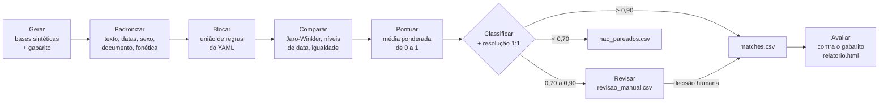

# record-linkage-kit

**Português** | [English](README.en.md)

[](https://github.com/agdala/record-linkage-kit/actions/workflows/ci.yml)
[](https://agdala.github.io/record-linkage-kit/)

Deduplicação e cruzamento de cadastros de pessoas (record linkage) em Python, com revisão humana, pseudonimização e avaliação contra um gabarito.

**Relatório de avaliação (GitHub Pages):** <https://agdala.github.io/record-linkage-kit/>

Um cadastro operacional de **5.000 registros** é cruzado com uma lista governamental de **3.000
registros**, cheia de erros realistas, com governança de dados e os princípios da LGPD como
referência de boas práticas. O resultado é medido contra um gabarito.

> [!IMPORTANT]
> **Todos os dados são 100% sintéticos**, gerados com Faker e semente fixa. Nenhum nome, documento
> ou data pertence a uma pessoa real, e nenhum segredo é versionado. Os números deste README são os
> obtidos com `make run` e estão em [`reports/metricas.json`](reports/metricas.json); o CI confere
> que eles se reproduzem a cada push.

---

## 1. Problema

Organizações humanitárias e órgãos públicos cadastram as mesmas pessoas em sistemas diferentes.
Cruzar essas bases é necessário para evitar assistência duplicada, encontrar quem ainda não acessou
um direito e unificar o histórico de cada pessoa. Mas não há um identificador comum confiável:

- o documento falta em boa parte dos registros (40% na lista governamental sintética);
- nomes aparecem sem acentos, sem "de", "da" e "dos", com sobrenomes em outra ordem, abreviados ou
  com erros de digitação;
- datas chegam com dia e mês trocados, registradas como 01/01 quando só o ano é conhecido, ou ausentes;
- a pessoa muda de município (por exemplo, na interiorização);
- há gêmeos, irmãos e homônimos que parecem a mesma pessoa.

O projeto mostra o processo completo, de ponta a ponta, com uma implementação própria e simples
(sem Splink, dedupe ou recordlinkage), e o mede contra um gabarito conhecido.

## 2. Fluxo



O mesmo fluxo roda sobre a base A contra ela mesma para a **deduplicação**
(`reports/duplicatas_a.csv`). Em paralelo, o **modo pseudonimizado** (`rlk pseudo`) faz o
cruzamento só com hashes, sem nomes em claro (seção 6).

## 3. Como rodar

### 3.1 No Windows, com o Visual Studio Code

1. Instale o **Python 3.10 ou superior** (Microsoft Store, "Python 3.12") e a extensão **Python**
   no VS Code (`Ctrl+Shift+X`, busque "Python").
2. Clone o repositório: `Ctrl+Shift+P`, digite **Git: Clone** e cole
   `https://github.com/agdala/record-linkage-kit`.
3. Abra o terminal (**Terminal > Novo Terminal**) e rode, um comando por vez:

```bash
python -m venv .venv
```

```bash
.venv\Scripts\Activate.ps1
```

```bash
pip install -e ".[dev]"
```

```bash
rlk generate
```

```bash
rlk link --config config/default.yaml
```

```bash
$env:RLK_SALT = python -c "import secrets; print(secrets.token_hex(32))"; rlk pseudo
```

```bash
rlk evaluate
```

Abra `reports\relatorio.html` no navegador.

> Se a ativação der erro de "execução de scripts desabilitada", rode uma vez
> `Set-ExecutionPolicy -Scope CurrentUser -ExecutionPolicy RemoteSigned` e repita.
> O Windows não traz o `make`; os comandos acima são exatamente o que o `make run` executa.
> O `rlk pseudo` é opcional: sem ele, o relatório só não mostra a seção do modo pseudonimizado.

### 3.2 No Linux ou macOS

```bash
python3 -m venv .venv && source .venv/bin/activate
```

```bash
pip install -e ".[dev]"
```

```bash
make run
```

`make run` executa `rlk generate`, `rlk link`, `rlk pseudo` (com um sal efêmero, se `RLK_SALT` não
estiver definido) e `rlk evaluate`. Leva cerca de 15 segundos.

### 3.3 Comandos

| Comando | O que faz |
|---|---|
| `rlk generate` | Gera `data/base_a.csv`, `data/base_b.csv` e `data/gabarito.csv` (semente 42) |
| `rlk link --config config/default.yaml` | Padroniza, bloca, compara, pontua, classifica, resolve 1:1 e deduplica a base A |
| `rlk pseudo` | Cruza as bases só por hashes SHA-256 com sal secreto (`RLK_SALT`) |
| `rlk evaluate` | Compara com o gabarito e gera `reports/metricas.json` e `reports/relatorio.html` |

### 3.4 Saídas

| Caminho | Conteúdo | No Git |
|---|---|---|
| `reports/matches.csv` | Pares aceitos automaticamente, com a similaridade de cada campo | Não |
| `reports/revisao_manual.csv` | Pares da faixa de revisão, campos das duas bases lado a lado, pontuação e coluna `decisao_revisor` | Não |
| `reports/nao_pareados.csv` | Registros de A e de B sem par, com a melhor pontuação obtida | Não |
| `reports/duplicatas_a.csv` | Duplicatas internas da base A | Não |
| `reports/candidatos.csv` | Todos os pares comparados, com pontuação (insumo do `evaluate`) | Não |
| `reports/resumo_link.json` | Contagens e registro do cruzamento (hash das bases e da configuração) | Não |
| `reports/metricas.json` | Todas as métricas da avaliação | **Sim** |
| `reports/relatorio.html` | Relatório autocontido, também publicado no Pages | **Sim** |

### 3.5 Testes

```bash
make test
```

São 78 testes (pytest) sobre a amostra sintética de `data/sample/` (200 + 120 registros): uma
regra de padronização ou fonética por teste, blocagem, comparação, pontuação, resolução 1:1,
avaliação, pseudonimização e o fluxo de ponta a ponta. O CI roda `ruff`, `pytest` e `make run` em
Python 3.10 e 3.12 a cada push.

## 4. Resultados

Bases: A com 5.000 registros (150 duplicatas internas), B com 3.000 registros, dos quais **1.800**
têm par em A. Limiares: match automático a partir de **0,90**, revisão manual de **0,70 a 0,90**
(a escolha está na seção 4.3).

### 4.1 Cruzamento A × B

| Indicador | Resultado |
|---|---|
| Pares possíveis sem blocagem | 15.000.000 |
| Pares candidatos após a blocagem | 138.897 (**redução de 99,07%**) |
| Completude da blocagem (pares verdadeiros entre os candidatos) | **99,4%** |
| Matches automáticos (≥ 0,90) | 1.710, com 4 falsos positivos |
| **Precisão automática** | **99,8%** |
| **Recall automático** | **94,8%** |
| F1 automático | 97,2% |
| Fila de revisão manual (0,70 a 0,90) | **164 pares** (5,5% da base B), 84 deles verdadeiros (51%) |
| **Recall após a revisão** (revisão correta) | **99,4%** |
| Precisão após a revisão (revisão correta) | 99,8% |

### 4.2 Troca entre precisão e recall

| Limiar | Pares aceitos | Falsos positivos | Precisão | Recall | F1 |
|---|---|---|---|---|---|
| 0,60 | 1.962 | 172 | 91,2% | 99,4% | 95,2% |
| 0,70 | 1.874 | 84 | 95,5% | 99,4% | 97,4% |
| 0,75 | 1.837 | 50 | 97,3% | 99,3% | 98,3% |
| 0,80 | 1.775 | 31 | 98,3% | 96,9% | 97,6% |
| 0,85 | 1.726 | 12 | 99,3% | 95,2% | 97,2% |
| **0,90** | **1.710** | **4** | **99,8%** | **94,8%** | **97,2%** |
| 0,95 | 1.546 | 0 | 100,0% | 85,9% | 92,4% |

O melhor F1 isolado está em 0,75, mas com 50 falsos positivos. O F1 trata os dois erros como
equivalentes, o que não vale para cadastros de pessoas (seção 4.3).

### 4.3 Escolha do limiar

**Os dois erros não custam o mesmo.** Um falso positivo funde duas pessoas diferentes: uma delas
pode ter a assistência negada por "já estar atendida", ou os históricos de proteção se misturam.
O erro é silencioso e difícil de desfazer depois que as decisões foram tomadas sobre o registro
fundido. Um falso negativo vai para a fila de revisão ou, no pior caso, gera um cadastro duplicado,
que aparece numa deduplicação posterior e é mais fácil de corrigir. Por isso o limiar automático
deve priorizar a precisão, e o recall perdido deve ser recuperado pela revisão humana, não pelo modelo.

Cenários com o limiar de revisão fixo em 0,70 (`cenarios_limiar` em
[`reports/metricas.json`](reports/metricas.json)):

| Limiar de match | Falsos positivos automáticos | Dos quais com perfil de gêmeos | Recall automático | Fila de revisão |
|---|---|---|---|---|
| 0,85 | 12 | 9 | 95,2% | 148 pares |
| **0,90 (adotado)** | **4** | **4** | **94,8%** | **164 pares** |
| 0,95 | 0 | 0 | 85,9% | 328 pares |

"Perfil de gêmeos": mesma mãe e mesma data de nascimento, sem documento para desempatar. Em
qualquer cenário, o recall após a revisão é de 99,4%, porque o limiar de revisão não muda.

**Por que 0,90:**

- passar de 0,85 para 0,90 elimina **8 dos 12 falsos positivos** (67%) em troca de **16 pares a
  mais** na fila (+11%) e de 0,4 ponto de recall automático. São 2 revisões a mais para cada fusão
  indevida evitada;
- os 4 falsos positivos que restam são todos gêmeos sem documento, um padrão que a pontuação não
  separa. A resposta para eles é uma regra de negócio (mesma mãe + mesma data + primeiro nome
  diferente vai sempre para revisão), não um limiar mais alto. Essa regra ainda não está
  implementada e é o primeiro item dos próximos passos (seção 9);
- 0,95 zera os falsos positivos, mas **dobra a fila** (328 pares, 164 a mais que em 0,90) para
  evitar os 4 erros restantes: 41 revisões a mais por fusão evitada, e o recall automático cai
  para 85,9%.
  Só se justifica se a equipe de revisão tiver essa capacidade.

O limiar deve ser recalibrado numa amostra rotulada de dados reais antes de qualquer uso (seção 8).

### 4.4 Blocagem por regra

| Regra (chaves) | Pares | Completude sozinha |
|---|---|---|
| `uf_ano` (UF + ano de nascimento) | 19.598 | 84,6% |
| `fonetica_nome_sexo` (fonética do primeiro nome + sexo) | 120.064 | 92,8% |
| `fonetica_sobrenome_ano` (fonética do último sobrenome + ano) | 2.489 | 80,2% |
| **União** | **138.897** | **99,4%** |

Nenhuma regra isolada passa de 93%; a união chega a 99,4%.

### 4.5 Deduplicação, pseudonimização e casos difíceis

| Indicador | Resultado |
|---|---|
| Deduplicação da base A (limiar 0,90) | 150 de 150 duplicatas, precisão e recall de 100% |
| Modo pseudonimizado (hashes, cascata de 4 chaves) | 1.504 pares, **precisão 100%, recall 83,6%** |

O modo pseudonimizado perde 11,2 pontos de recall em relação ao automático aproximado (94,8%) e
15,9 pontos em relação ao resultado com revisão (99,4%). Esse é o custo de não trocar nomes em claro.

O [relatório](https://agdala.github.io/record-linkage-kit/) traz ainda o recall por tipo de erro e
**cinco casos difíceis comentados**. Os mais instrutivos:

- os falsos positivos com pontuação alta são **gêmeos**: mesma mãe, mesma data, mesmo município,
  só o primeiro nome muda. Sem documento, só um limiar de 0,95 os elimina, ao custo de dobrar a fila;
- datas registradas como **01/01** (só o ano conhecido) têm recall automático de apenas 5%, mas
  100% depois da revisão: a pontuação cai para a faixa de revisão, como deveria;
- registros **sem data de nascimento** ficam com 91,9% de recall mesmo com revisão: duas das três
  regras de blocagem dependem do ano.

## 5. Como funciona

### 5.1 Padronização ([`standardize.py`](src/rlk/standardize.py))

Maiúsculas, remoção de acentos, pontuação e espaços duplos, remoção opcional das partículas
(DE, DA, DO, DAS, DOS, E e as espanholas DEL, LA, LOS, Y), datas ISO e DD/MM/AAAA, sexo em F/M
(FEMININO, MASCULINO...) e documento só com dígitos.

**Chave fonética para português**, aplicada a cada palavra, nesta ordem:

| # | Regra | Exemplo (efeito só desta regra) |
|---|---|---|
| 1 | Ç vira S | CONCEIÇÃO → CONSEISAO |
| 2 | H inicial é mudo | HELENA → ELENA |
| 3 | PH vira F | RAPHAEL → RAFAEL |
| 4 | TH vira T | THAIS → TAIS |
| 5 | LH vira LI | GUILHERME → GUILIERME |
| 6 | NH vira NI | MARINHO → MARINIO |
| 7 | CH e SH viram X | CHAVES → XAVES |
| 8 | H restante é mudo | JOHANA → JOANA |
| 9 | SC antes de E/I vira S | NASCIMENTO → NASIMENTO |
| 10 | C antes de E/I vira S | CECILIA → SESILIA |
| 11 | QU antes de E/I vira K | HENRIQUE → ENRIKE |
| 12 | Q vira K | QUADROS → KUADROS |
| 13 | C restante vira K | CARLOS → KARLOS |
| 14 | G antes de E/I vira J | GISELE → JISELE |
| 15 | Y vira I | YASMIN → IASMIN |
| 16 | W vira V | WAGNER → VAGNER |
| 17 | Z vira S | SOUZA → SOUSA, LUIZ → LUIS |
| 18 | X entre vogais vira S | ALEXANDRE → ALESANDRE |
| 19 | SS vira S | VANESSA → VANESA |
| 20 | M antes de consoante ou no fim vira N | MIRIAM → MIRIAN |
| 21 | Letras repetidas viram uma | MATTOS → MATOS |

Cada regra tem um teste em [`tests/test_standardize.py`](tests/test_standardize.py).

### 5.2 Blocagem, comparação e pontuação

Tudo é configurado em [`config/default.yaml`](config/default.yaml):

- **Blocagem:** cada regra lista as chaves que precisam coincidir; o conjunto de candidatos é a
  união das regras. Uma chave vazia não gera par (vazio não é evidência).
- **Comparação:** Jaro-Winkler para nome e nome da mãe (também com as palavras em ordem
  alfabética, para sobrenomes invertidos); níveis para a data (igual 1,0, dia e mês trocados 0,8,
  só o ano 0,3, diferente 0); igualdade para sexo, município + UF e documento.
- **Pontuação:** média ponderada das similaridades, de 0 a 1. Pesos: nome 0,35, data 0,25, nome da
  mãe 0,15, documento 0,15, sexo 0,05, município 0,05. **Campo ausente sai do numerador e do
  denominador**, então a falta de documento não penaliza o par.
- **Classificação e 1:1:** pares acima do limiar de revisão são ordenados pela pontuação e aceitos
  um a um, sem repetir registro (resolução gulosa). Depois, cada par é classificado em match,
  revisão ou não match.

### 5.3 Avaliação

O recall é medido **por registro de B**: um registro com par conta como encontrado se for ligado
a qualquer registro de A da mesma pessoa (a pessoa pode estar duplicada em A). A completude da
blocagem mede os pares verdadeiros que chegaram a ser comparados; ela é o teto do recall.

## 6. Proteção de dados

O projeto adota os princípios da LGPD (finalidade, necessidade, segurança, minimização) como
**referência de boas práticas**. Cada organização que fizer um cruzamento real deve observar o marco
legal e as políticas internas de proteção de dados aplicáveis a ela; organismos internacionais, por
exemplo, têm privilégios e imunidades e políticas próprias. A nota não é um parecer jurídico.

A nota completa está em [`docs/protecao_de_dados.md`](docs/protecao_de_dados.md): finalidade e base
legal, minimização, papéis de controlador e operador, registro do cruzamento, retenção, quem
acessa a fila de revisão e por que existe revisão humana.

**Modo pseudonimizado** ([`pseudonymize.py`](src/rlk/pseudonymize.py)): duas organizações combinam
um sal secreto fora do Git (variável `RLK_SALT`), cada uma calcula o SHA-256 com sal (HMAC) de
chaves padronizadas da própria base e só os hashes são trocados. Limites, detalhados na nota:

| Limite | Consequência |
|---|---|
| Ataque de dicionário | Quem tem o sal (inclusive a outra parte) pode testar listas de nomes e datas. O hash é **pseudonimização, não anonimização**: continua sendo dado pessoal. |
| Acordo de compartilhamento | Esconder os nomes não dispensa base legal, acordo, proibição de reidentificação e destruição do sal. |
| Perda do pareamento aproximado | Um erro de digitação muda o hash. Recall de 83,6%, contra 94,8% (aproximado) e 99,4% (com revisão). |

## 7. Decisões técnicas

| Decisão | Motivo |
|---|---|
| **Implementação própria, sem Splink, dedupe ou recordlinkage** | Cada etapa fica visível e testável em poucas linhas, o que serve ao objetivo de demonstrar e auditar o processo. A comparação com o Splink é um próximo passo. |
| **Dados sintéticos com erros documentados no gabarito** | Permite medir precisão e recall de verdade e explicar cada erro do modelo pelo erro introduzido (recall por tipo de erro). Nenhum dado real é necessário, nem no CI. |
| **Faker com versão fixa (`faker==40.44.0`)** | A mesma semente só gera os mesmos dados com a mesma versão. O CI confere que `metricas.json` se reproduz em Python 3.10 (pandas 2) e 3.12. |
| **Gêmeos, irmãos e datas 01/01 no gerador** | Sem eles, a primeira versão chegava a 99,9% de precisão e 99,6% de recall: fácil demais para mostrar por que a revisão humana existe. |
| **União de três regras de blocagem** | Nenhuma regra isolada passa de 93% de completude; a união chega a 99,4% e ainda corta 99,07% dos pares. |
| **Média ponderada que ignora campos ausentes** | A falta de documento (40% em B) ou do nome da mãe não deve derrubar a pontuação de um par que coincide em todo o resto. |
| **Jaro-Winkler também com tokens ordenados** | Recupera sobrenomes invertidos sem uma comparação palavra a palavra mais cara. |
| **Dois limiares e revisão humana** | Os falsos positivos de pontuação alta (gêmeos) não se resolvem com limiar. A revisão cobre a faixa em que o modelo é incerto, em linha com o princípio de revisão de decisões automatizadas (art. 20 da LGPD). |
| **Resolução 1:1 gulosa** | Simples, determinística e suficiente quando cada pessoa aparece uma vez em B. Um único passe serve a todos os limiares da avaliação. |
| **HMAC-SHA256 em vez de SHA-256(sal + valor)** | É a construção padrão para hash com segredo e evita o ataque de extensão de comprimento do SHA-256 puro; continua sendo "SHA-256 com sal secreto". |
| **Relatório HTML único, sem bibliotecas externas** | Gráfico em SVG gerado em Python, abre offline e é publicado no Pages como um arquivo só. |
| **`metricas.json` e `relatorio.html` versionados; CSVs com registros fora do Git** | Os números do README ficam rastreáveis sem versionar tabelas com nomes, mesmo sintéticos. |

## 8. Limitações

- **Avaliação otimista: o gerador e o modelo foram criados pela mesma autora.** Os tipos de erro
  do gerador, os pesos, os níveis de comparação e as regras de blocagem foram desenhados pela mesma
  pessoa, sabendo quais erros existiam. O limiar de 0,90 também foi escolhido olhando para esses
  mesmos dados. Por isso o desempenho medido tende a ser **otimista** em relação a dados reais, que
  têm padrões de erro não previstos (transliteração de nomes, troca de nome após casamento,
  registros de terceiros, documentos digitados errado). Mitigações previstas: estimar os pesos pelo
  modelo **Fellegi-Sunter com o algoritmo EM**, a partir dos próprios dados e sem o gabarito, e
  **comparar com o Splink** nas mesmas bases (seção 9). Numa base real, a referência deve ser uma
  amostra rotulada por revisores, separada da usada para calibrar.
- **Dados sintéticos são mais regulares que os reais.** As taxas de erro foram escolhidas, não
  medidas em bases reais; os números servem para comparar métodos, não para prometer resultados.
- **Pesos e limiares definidos à mão.** Não foram estimados dos dados (como no modelo
  Fellegi-Sunter); numa base real, precisam ser calibrados numa amostra rotulada.
- **Deduplicação fácil demais.** As duplicatas internas de A têm só 1 ou 2 erros leves, por isso
  100% de precisão e recall. Duplicatas reais tendem a ser mais difíceis.
- **Resolução 1:1 gulosa** não é ótima globalmente e não forma grupos (clusters) com mais de dois
  registros na deduplicação.
- **Registros sem data de nascimento** dependem de uma única regra de blocagem (91,9% de recall
  mesmo com revisão).
- **Chave fonética simplificada:** pensada para nomes em português, trata nomes em espanhol só
  parcialmente (por exemplo, não iguala LL e Y).
- **A avaliação da revisão supõe um revisor perfeito.** Na prática, a fila também tem erros.
- **Escala:** a comparação é feita em Python puro e roda em segundos para milhares de registros;
  para milhões, seria preciso vetorizar ou usar um motor como DuckDB ou Spark.

## 9. Próximos passos

1. **Regra de gêmeos sem documento** (ainda não implementada): todo par com mesma mãe, mesma
   data de nascimento, primeiro nome diferente e sem documento para comparar (ausente em pelo
   menos um dos registros) vai para a fila de revisão, qualquer que seja a pontuação. O objetivo é
   tirar do match automático os 4 falsos positivos restantes (seção 4.3) sem subir o limiar.
   Cuidado: a regra também desvia para a fila pares verdadeiros cujo primeiro nome tem erro de
   digitação ou abreviação. O custo na fila precisa ser medido e publicado em `metricas.json`
   antes de adotá-la, e o critério pode exigir similaridade baixa do primeiro nome, não só diferença.
2. **Comparar com o Splink** nas mesmas bases e com o mesmo gabarito.
3. **Fellegi-Sunter com EM:** estimar as probabilidades m e u e os pesos de cada nível de
   comparação a partir dos dados, em vez de pesos fixos.
4. Regra de blocagem por documento e por fonética do nome completo, para recuperar os pares
   perdidos sem data.
5. Agrupamento (clusters) na deduplicação, para pessoas com três ou mais registros.
6. Pareamento pseudonimizado aproximado com filtros de Bloom (privacy-preserving record linkage).
7. Medir a concordância entre revisores na fila de revisão.

## 10. Estrutura do repositório

```
record-linkage-kit/
├── src/rlk/            # generate, standardize, blocking, compare, link, evaluate, report, pseudonymize, cli
├── config/             # default.yaml: blocagem, pesos, níveis de data, limiares
├── tests/              # pytest com a amostra sintética
├── docs/               # protecao_de_dados.md
├── data/               # bases geradas (fora do Git), exceto data/sample/
├── reports/            # metricas.json e relatorio.html versionados; demais saídas fora do Git
└── .github/workflows/  # ci.yml (ruff + pytest + make run) e pages.yml (relatório no Pages)
```

## English summary

**record-linkage-kit** is a portfolio project on deduplication and linkage of person registries
with data governance, using the principles of Brazil's data protection law (LGPD) as a
good-practice reference, built on **100% synthetic data**.
A synthetic operational registry (5,000 records, 3% internal duplicates) is linked to a synthetic
government list (3,000 records, 60% overlap) that carries realistic errors: missing accents and
particles, typos, reordered and abbreviated surnames, swapped day and month, 01/01 placeholder
dates, missing documents (40%) and dates (5%), relocated people, twins and siblings.

The pipeline is a small, hand-written Python implementation (pandas, rapidfuzz): standardization
with a 21-rule Portuguese phonetic key, configurable blocking (union of rules, 99.07% pair
reduction, 99.4% pair completeness), Jaro-Winkler and level-based comparisons, a weighted score
from 0 to 1 that ignores missing fields, two thresholds (auto-match and manual review) and greedy
1:1 resolution. Against the ground truth, auto-matches reach **99.8% precision and 94.8% recall**
at 0.90; a review queue of 164 pairs (5.5% of list B) lifts recall to **99.4%**. A pseudonymized
mode (salted SHA-256 via HMAC, salt kept in an environment variable) links without exchanging
names, at **100% precision and 83.6% recall**: the measured cost of losing approximate matching.
The evaluation report is published on GitHub Pages; CI runs ruff, pytest and the full pipeline and
checks that the published metrics are reproduced.

## Projetos relacionados

Os quatro repositórios formam um ciclo de dados, da coleta ao monitoramento:

| Etapa | Projeto | O que faz | Publicado |
|---|---|---|---|
| 1. Coletar | [xlsform-validator](https://github.com/agdala/xlsform-validator) | Qualidade, consentimento e LGPD em formulários KoboToolbox/ODK | [versão web](https://agdala.github.io/xlsform-validator/) |
| 2. Transformar e publicar | [sismigra-analytics](https://github.com/agdala/sismigra-analytics) | Pipeline bronze/prata/ouro com Python, DuckDB e dbt, com controle de divulgação | [dbt docs](https://agdala.github.io/sismigra-analytics/) |
| 3. Integrar | **record-linkage-kit** (este repositório) | Deduplicação e cruzamento de cadastros, com revisão humana e pseudonimização | [relatório](https://agdala.github.io/record-linkage-kit/) |
| 4. Monitorar | [monitoring-5w-kit](https://github.com/agdala/monitoring-5w-kit) | Relatos de parceiros, metas e dupla contagem | [relatório](https://agdala.github.io/monitoring-5w-kit/) |

Autoria: Agda Santos, com auxílio de ferramentas de IA.

## Licença

MIT. Veja [LICENSE](LICENSE).
